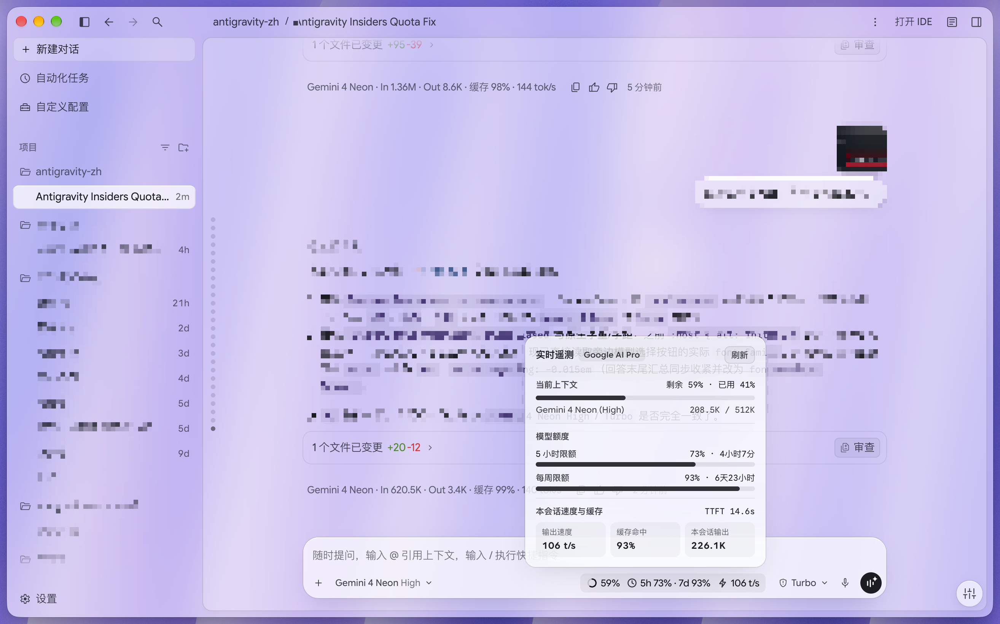

# antigravity-zh

适用于 macOS 版 **Antigravity** 与 **Antigravity - Insiders** 的中文汉化、毛玻璃外观与状态监控工具。所有设置实时生效，应用更新后自动保留，也可随时还原原版。



## 主要功能

- **界面汉化**：覆盖主界面、设置、Swarm 面板、macOS 顶部菜单栏、右键菜单与系统弹窗，不改动聊天内容、代码块、终端输出和内置浏览器网页。
- **状态监控与首页看板**：输入框底部实时显示上下文剩余量、5 小时与每周额度及输出速度；每条回答末尾显示本轮模型、输入/输出 token、缓存命中率和速度；新建对话页展示活跃热力图、模型分布与 API 折算估值（悬停可查看单日明细，支持合并统计正式版与 Insiders）。
- **原生毛玻璃**：自动适配浅色与深色主题，可调节透明度或一键关闭，设置弹窗与内置网页保持清晰不透底。
- **阅读与交互增强**：可自定义点击文件链接的行为（右侧边栏预览、在 Finder 中显示或用系统默认软件打开），并支持长代码块顶栏吸顶与折叠、吐字淡入动效及平滑光标。
- **统一设置面板与更新保活**：点击窗口右下角圆形图标即可实时调节全部选项，无需重启；同时兼容 `Antigravity` 和 `Antigravity - Insiders`，配置独立保存，应用更新后自动保留。

## 安装

### macOS（同时支持正式版与 Insiders）

在系统自带的「终端（Terminal）」中运行：

```bash
git clone https://github.com/luanyufei/antigravity-zh.git
cd antigravity-zh
./install.sh
```

完成后按 `⌘Q` 完全退出并重新打开 Antigravity 即可。

> **权限提示**：如果由 Antigravity 里的 Agent 代为安装，macOS 的「App 管理」权限可能会拦截跨应用修改。若另一个版本未生效，打开系统「终端」运行 `agy-i18n patch` 即可，或在「系统设置 → 隐私与安全性 → App 管理」中放行后重试。

如果安装脚本运行失败，可以直接把下面这句话发给 Antigravity 或其他 Agent：

```text
帮我装好这个项目：https://github.com/luanyufei/antigravity-zh
```

### Windows / Linux

把下面这句话发给 Antigravity 或其他 Agent：

```text
这个项目目前只支持 macOS：https://github.com/luanyufei/antigravity-zh ，我现在用的是 Windows（或 Linux），请参考它的实现和词典，帮我适配并安装到当前系统。
```

## 日常使用

- **设置面板**：点击窗口右下角圆形图标打开（按住可拖动位置，双击复位）；如果隐藏了图标，可从顶部菜单栏重新打开。
- **快捷键**：`⌘⌥L` 切换中英文，`⌘⌥T` 开关毛玻璃。
- **自定义词条**：编辑 `~/.config/antigravity-insiders-i18n/dict/custom.json`，保存后自动生效。

## 同步更新

想拉取最新的词典补全或功能更新，直接对 Antigravity 或其他 Agent 说：

```text
请检查 https://github.com/luanyufei/antigravity-zh 的最新变动，帮我把最新的词典和脚本同步更新到本地。
```

## 常用命令与卸载

```bash
agy-i18n status           # 查看当前安装、签名与守护状态
agy-i18n lang toggle      # 切换中英文（可加 --target insiders 或 --target stable）
agy-i18n restore          # 还原为 Google 官方原版
./uninstall.sh            # 卸载并还原应用
```

也可以直接对 Antigravity 或其他 Agent 说：

```text
请帮我卸载 antigravity-zh。
```

## License

[MIT](LICENSE)
