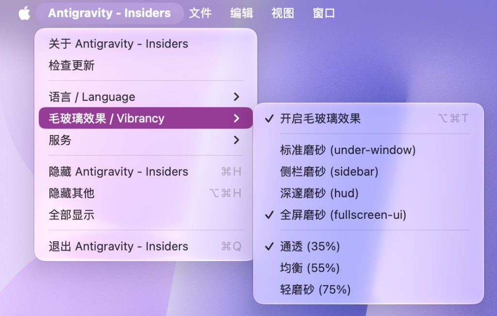

# antigravity-zh

更适合中国宝宝体质的 **Antigravity** 增强工具（**仅支持 macOS**，**同时兼容 Antigravity 与 Antigravity - Insiders**）：提供**完整中文汉化**与 **macOS 原生毛玻璃效果**，两者都支持实时热切换，应用更新后自动保持生效。

## 它能做什么

- **双版本自动适配与独立设置**：安装时自动检测电脑上是否安装了 `Antigravity` 和 `Antigravity - Insiders`——两个都装了就同时支持，只装了一个就只处理那一个；两个应用的语言状态和毛玻璃档位**完全独立保存**，互不影响。
- **界面全面汉化**：覆盖主界面、设置页、Swarm 面板、macOS 顶部菜单栏、原生右键菜单、托盘菜单和系统弹窗，不误伤聊天内容、代码块、终端输出和内置浏览器网页。
- **macOS 原生毛玻璃（Vibrancy）**：调用系统底层 `NSVisualEffectView` 实现半透明磨砂质感，自动适配深色/浅色主题；设置弹窗与内置网页保持不透明，不影响阅读。
- **中英文与毛玻璃均支持实时热切换**：不用重启应用，也不破坏原版布局。
- **自动更新保活**：应用自动更新或手动覆盖安装后自动重新注入，不需要每次更新完重新折腾。
- **可无损还原**：按版本独立备份原始文件，随时可以一条命令还原回 Google 官方签名原版。

## 安装

目前这个项目的安装脚本**同时直接支持 macOS 版的 Antigravity（正式版）与 Antigravity - Insiders（预览版）**，会自动检测本机安装情况。

### macOS 用户（Antigravity / Antigravity - Insiders）

建议直接在 **macOS 自带的「终端（Terminal）」** 中执行（如系统弹出「允许更新其他 App」提示，点「允许」即可）：

```bash
git clone https://github.com/luanyufei/antigravity-zh.git
cd antigravity-zh
./install.sh
```

运行完成后，按 `⌘Q` 完全退出并重新打开对应的 Antigravity 应用即可生效。

> **权限提示**：如果你是让 Antigravity 里的 Agent 帮你安装，或同时装了 `Antigravity` 和 `Antigravity - Insiders`，macOS 的「App 管理」隐私保护会拦截一个 App 去修改另一个 App（比如在 Insiders 里运行的 Agent 无法直接给普通版 `Antigravity.app` 打补丁）。遇到「无权修改 `/Applications/...`」或另一个版本未生效时，打开系统 **「终端（Terminal）」** 手动执行一行命令补打即可：
>
> ```bash
> agy-i18n patch
> ```
>
> 也可以前往 **「系统设置 → 隐私与安全性 → App 管理」** 勾选允许当前终端或应用修改其他 App 后再重试。

如果安装脚本运行失败，请打开 Antigravity 或其他 Agent，对它说：

```text
帮我装好这个项目：https://github.com/luanyufei/antigravity-zh
```

### Windows / Linux 用户

打开 Antigravity 或其他 Agent，对它说：

```text
这个项目目前只支持 macOS：https://github.com/luanyufei/antigravity-zh ，我现在用的是 Windows（或 Linux），请你参考它的汉化引擎和词典，帮我适配并安装到当前系统。
```

## 同步最新汉化与毛玻璃样式

如果仓库更新了词典补全、毛玻璃样式或修复，想同步最新改动到本地，可以直接打开 Antigravity 或其他 Agent，对它说：

```text
请你检查 https://github.com/luanyufei/antigravity-zh 的最新变动，帮我把最新的汉化词典和脚本同步更新到本地。
```

## 中英文随时切换

安装后，下面四种方式都可以随时在中文和英文之间实时切换，不需要重启：

- 点击窗口右下角的悬浮按钮 `中 | EN`（按住可拖动位置，双击复位）
- 顶部菜单栏 `Antigravity` / `Antigravity - Insiders` → `语言 / Language`
- 快捷键 `⌘⌥L`
- 终端命令：`agy-i18n lang en` / `agy-i18n lang zh-CN` / `agy-i18n lang toggle`（加 `--target insiders` 或 `--target stable` 可只切换其中一个应用）

## 毛玻璃效果与调节

安装后默认开启毛玻璃效果，默认档位为：**全屏磨砂 (`fullscreen-ui`) + 均衡 (`55%`)**。



### 如何调节

打开顶部菜单栏 **`Antigravity` / `Antigravity - Insiders` → `毛玻璃效果 / Vibrancy`**，所有选项点击后**实时生效，无需重启**：

- **4 种 macOS 原生磨砂材质**：
  - `标准磨砂 (under-window)`：贴近 macOS 常规窗口背景磨砂
  - `侧栏磨砂 (sidebar)`：类似访达侧边栏的柔和通透感
  - `深邃磨砂 (hud)`：暗色模式在亮色壁纸下更有层次感
  - `全屏磨砂 (fullscreen-ui)`（**默认**）：通透均匀，明暗主题观感都比较柔和
- **3 档透明度**：
  - `通透 (35%)`：透出更多桌面壁纸
  - `均衡 (55%)`（**默认**）：通透感与文字可读性的折中
  - `轻磨砂 (75%)`：更偏实色，适合复杂壁纸下长时间阅读

也可以直接编辑各自应用的配置 `~/.config/antigravity-insiders-i18n/local-plugins/vibrancy-insiders.json` / `vibrancy-stable.json` 或共享样式 `~/.config/antigravity-insiders-i18n/local-plugins/vibrancy-assets/style.js` 自定义参数，保存后自动热重载。两个应用的毛玻璃开关和档位彼此独立，互不干扰。

### 不喜欢怎么关闭

- **随时一键开关**：在顶部菜单栏取消勾选 **`开启毛玻璃效果`**，或按快捷键 **`⌘⌥T`**，窗口会立刻恢复为原版 100% 不透明界面，且设置会自动保存（下次启动也不会再开）。
- **彻底移除毛玻璃插件（只留汉化）**：删除 `~/.config/antigravity-insiders-i18n/local-plugins/vibrancy.js` 后按 `⌘Q` 重启一次应用即可。

## 常用命令与卸载

```bash
agy-i18n status           # 查看已检测到的两个版本汉化、签名、毛玻璃和更新守护状态
agy-i18n uninstall-agent  # 关闭后台更新监听守护（平时不占 CPU 和内存）
agy-i18n restore          # 从备份还原为官方原版签名
./uninstall.sh            # 卸载汉化与毛玻璃并还原应用
```

如果你卸载失败或者不会卸载，可以直接打开 Antigravity 或其他 Agent，对它说：

```text
请你帮我卸载 antigravity-zh。
```

如果想自己微调某些词条的翻译，可以直接编辑 `~/.config/antigravity-insiders-i18n/dict/custom.json`，保存后自动热生效。

## License

[MIT](LICENSE)
